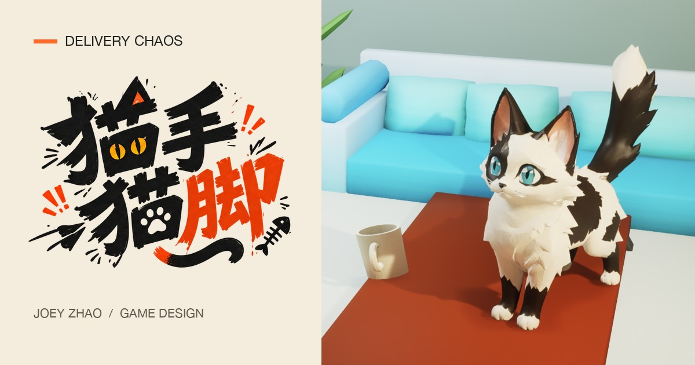
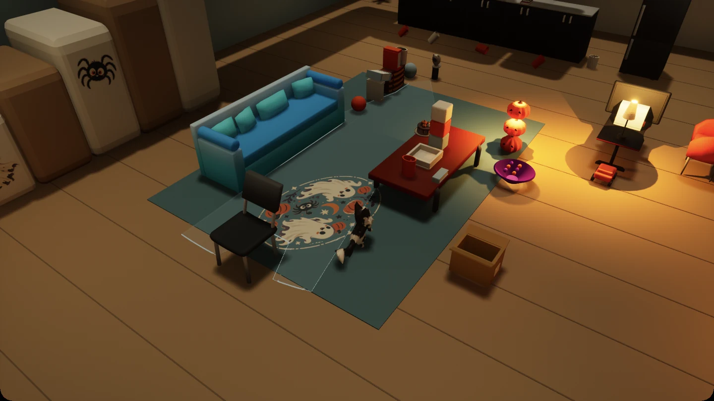
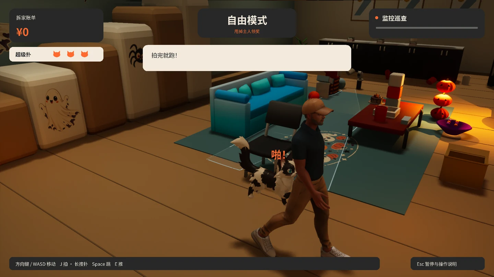
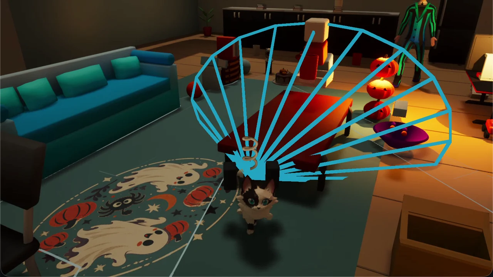
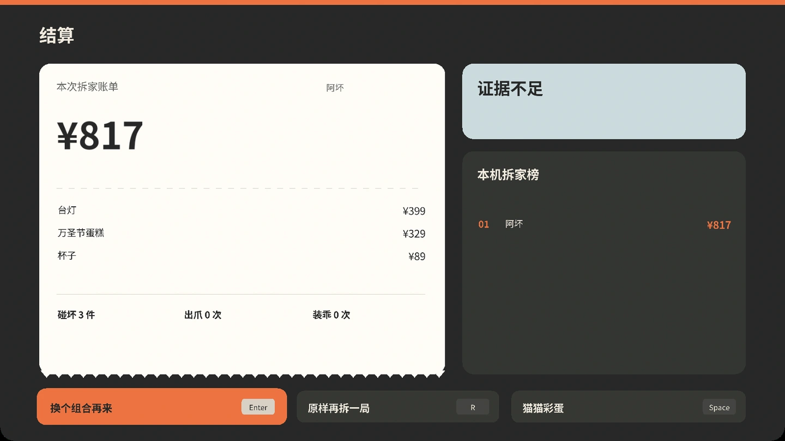

  

# 猫手猫脚 · Delivery Chaos

**杯子还差半爪就掉下去了。偏偏这时候，监控转过来了。**

在万圣节派对开始前，把客厅拆出一张能吓到主人的账单。挥爪拍东西，轻轻推落一个杯子，或一头撞翻糖果碗。金币叮叮当当地飞进账单，你还有空收爪坐好，装作什么都没发生。

[看 15 秒实机](https://joeyzhao.cc/delivery-chaos#play) · [查看试玩发布](https://github.com/joeymilano/DELIVER-CHAOS/releases) · [English overview](https://joeyzhao.cc/en/delivery-chaos)

## 怎么玩

- **拆家赚钱。** 轻拍、慢推、暴冲，或者扭着屁股蓄力扑出去。杯子、台灯和南瓜灯各有标价，碎了就上账单。
- **被发现就跑。** 监控视野扫过地毯，来不及溜走就坐下装乖。也可以趁主人背对你拍他一爪。能甩掉追捕，这一爪值 ¥500。
- **换只猫再来。** 纸箱里藏着橘团，最高的南瓜灯旁有大福的线索。找到新猫就能带回去合成。阿坏加乌梅，暴冲撞东西时还会放出一道音波。
- **合出大坏猫。** 找齐四只猫、试完三种其他配方，再把阿坏和大福放在一起。变大之后，连电视也推得动。

**180 秒挑战**看你能拆出多少钱，上本机排行榜。**自由拆家**不限时，适合摸路线、找藏起来的猫。

## 游戏截图

| 万圣节客厅 | 拍完这一下，赶紧跑 |
| --- | --- |
|  |  |
| **合成噪音炸弹，一撞就喵** | **最后把账单留给主人** |
|  |  |

截图来自 Mac 试玩包和开发版实机。

## 试玩下载

公开试玩包准备中。Mac 已有 Apple 芯片本地试玩版，Windows 正在等待可玩包。正式试玩文件会放在 [GitHub Releases](https://github.com/joeymilano/DELIVER-CHAOS/releases) 的 **Assets**，GitHub 自动生成的 Source code 是给开发者用的。

试玩版可以用键盘游玩。**方向键或 WASD** 移动，**J** 挥爪或蓄力扑，**E** 慢推，**Shift** 暴冲，**空格** 跳跃，**Esc** 打开操作说明。

---

Unreal Engine 5 游戏原型 · Vibe Hacks #06

[设计与制作案例](https://joeyzhao.cc/delivery-chaos) · [开发与协作](CONTRIBUTING.md) · [Windows 构建说明](WINDOWS_README.md)
